# 用 Claude Code 打造一條龍的開發工作流

## 前言：AI 寫 code 不難，難的是「不偏離」

用 AI agent 寫程式一段時間後，我遇到的問題幾乎都不是「它寫不出來」，而是：

1. **設定散落各處**：十幾個 repo，每個都有自己的 `CLAUDE.md`、skills、agent 定義，改一個規則要改十個地方。
2. **成果與預期落差大**：需求沒問清楚就開工，寫完才發現方向錯了。
3. **協作與進度不透明**：work item、PR、sprint 都在 Azure DevOps，但切網頁很打斷思考。
4. **部署很手工**：build image、push registry、改 deployment、失敗了再手動 rollback。
5. **公司與個人混在一起**：公司的 skill、memory 跑進個人專案，反之亦然。
6. **上線之後看不見**：服務出事只能翻 log。

這篇文章把我目前的解法整理成一套系統。先看全貌：

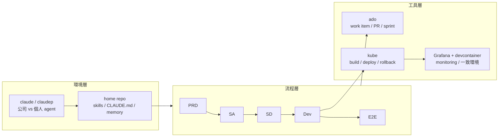

| 問題 | 解法 | 章節 |
|---|---|---|
| 多 repo 的 skills / agent / memory 怎麼維護、怎麼互相可見 | **home repo** | 1 |
| 怎麼先把需求與設計想清楚再開工 | **dev flow** + `grill-me` | 2 |
| 協作、專案管理、時間管理、進度追蹤 | **ado** CLI | 3 |
| 測試環境的自動部署、自動回滾、資源管理 | **kube** CLI | 4 |
| 公司 / 個人 agent 分離 | **claude / claudep** | 5 |
| 上線後的 monitoring 與 metrics | **Grafana + devcontainer** | 6 |
| 實際跑一次長什麼樣子 | **範例：裝置流量暴增** | 7 |

---

## 1. home repo：所有設定的單一來源

### 1.1 問題

Claude Code 的設定有很多層：`~/.claude/CLAUDE.md`（全域）、每個專案根目錄的 `CLAUDE.md`、`~/.claude/skills/`、`~/.claude/agents/`、各專案的 memory。repo 一多，就會出現：

- 同一條規則（例如「commit 不准帶 AI attribution」）在五個地方各寫一次，而且版本不一致；
- skill 直接改在 `~/.claude/skills` 裡，沒有版本控制，換電腦就沒了；
- 每個 repo 只看得到自己，要做跨服務的 E2E integration 時，agent 不知道另一個 repo 在哪。

### 1.2 解法：一個 git repo + symlink

我把所有東西收進一個 repo（`~/workspace/home`），再用一支 `home` CLI 把它 **symlink** 到 Claude Code 會讀的位置。原則只有一條：**`~/.claude` 底下的東西永遠不直接改，只改 home repo。**

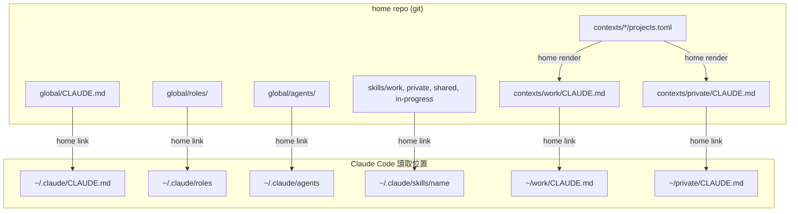

repo 結構：

| 路徑 | link 到 | 內容 |
|---|---|---|
| `global/CLAUDE.md` | `~/.claude/CLAUDE.md` | 只放情境切換與通用風格 |
| `global/roles/` | `~/.claude/roles` | PO / SA / SD / Dev / Rev 角色卡 |
| `global/agents/` | `~/.claude/agents` | subagent 定義 |
| `contexts/work/CLAUDE.md` | 公司根目錄的 `CLAUDE.md` | 所有公司流程規則 |
| `contexts/private/CLAUDE.md` | 個人根目錄的 `CLAUDE.md` | 個人專案規則 |
| `contexts/*/projects.toml` | （`home` 讀取） | project alias |
| `skills/<bucket>/<name>/` | `~/.claude/skills/<name>` | 我自己寫的 skills |

### 1.3 用「目錄」切換情境

Claude Code 會**從工作目錄往上**找 `CLAUDE.md`。所以只要把情境檔 link 到各自的根目錄，情境就自動切換，不需要手動宣告：

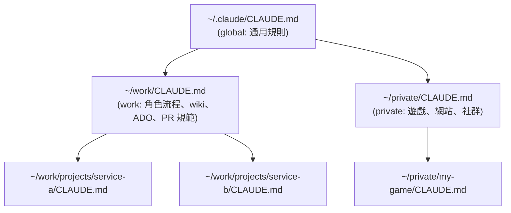

在 `~/work/projects/service-a` 裡開 Claude，會同時載入 global + work + 該 repo 的規則；在 `~/private/my-game` 裡則是 global + private。兩邊的規則互不污染。

### 1.4 Skills 的分桶

| bucket | 用途 |
|---|---|
| `work/` | 公司的日常主力（dev 流程、wiki、ADO、部署） |
| `private/` | 穩定的個人 skill |
| `shared/` | 兩邊都用（例如 `ask-home` 路由器） |
| `in-progress/` | v0，還在被真實使用打磨，活過幾次 session 沒改才升級 |

除此之外還有兩種「外部 skill」：

- **wiki 擁有的 skill**（如 PRD / SA / SD 的撰寫 skill）：放在團隊 wiki 裡，由 `skills/external.toml` 宣告後 link，不複製一份，避免分叉；
- **團隊 repo 的 skill**：由 `home team pull` 同步並 link。同名時我自己的優先，被蓋掉的會在 `home team status` 列出來。反過來，`home team publish <skill>` 可以把我的 skill 推回團隊 repo 的 feature branch。

### 1.5 讓 repo 之間互相 visible：project alias

做 E2E integration 時，agent 常要跨 repo：「去 service-b 看一下它怎麼 publish 這個 event」。如果路徑寫死在 skill 裡，repo 一搬家全部壞掉。所以所有路徑都集中在 `projects.toml`：

```toml
[projects.tx]
path = "~/work/projects/transceiver"
kind = "service"

[projects.kube]
path = "~/work/tools/kube"
kind = "tool"
note = "OUR tool: deploy microservices to k3s servers"
```

- `home proj <alias>`：解析路徑，skill 一律透過它找 repo；
- `p <alias>`：shell 裡直接 `cd` 過去；
- `home render`：把 alias 表重新寫進情境 `CLAUDE.md`，所以**每個 session 一開始 agent 就知道所有 repo 在哪**。

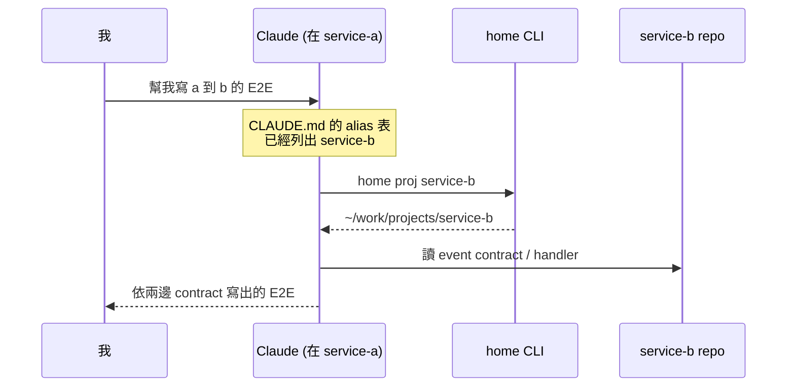

### 1.6 不可外流的值與健檢

- **秘密**（PAT、token、密碼）永遠不進 repo，留在各工具自己的設定檔或環境變數；
- **真實環境值**（主機名、IP、tenant、裝置 ID、同事 email）放在 gitignored 的 `local.toml`，skill 裡只寫 `{{KEY}}` 佔位符，執行時才用 `home local get KEY` 取出；
- pre-commit hook 會掃描 staged diff，只要出現 `local.toml` 裡的任何值就拒絕 commit；
- `home doctor` 檢查所有 link、專案路徑、wiki 路徑是否還活著。

### 1.7 Memory

Claude Code 的 memory 是「每個專案一個目錄、每個事實一個檔案」，加上一份 `MEMORY.md` 索引。我的原則：

- **repo 已經記錄的不存**（程式結構、git history、CLAUDE.md 裡的規則）；
- **只存非顯而易見的事**：使用者偏好、被糾正過的做法、還沒寫進 code 的專案限制；
- 能升級成規則的，就從 memory 移到 home repo 的 `CLAUDE.md` 或 skill，讓它進版本控制。

---

## 2. Dev Flow：先想清楚再動工

### 2.1 問題

AI 最大的風險不是寫錯，而是**很有效率地寫出你不要的東西**。人類工程師會在寫之前問問題，agent 預設會直接動手。所以我把開發強制拆成五個階段，每個階段都有負責角色、產出文件和驗收標準（DoD），**前一關沒過，下一關不開工**。

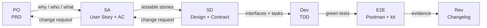

### 2.2 grill-me：讓 agent 反過來拷問你

整條流程的核心工具是 `grill-me` 這個 skill：**讓 agent 不斷追問，直到把決策樹的每一個分支都解決**。它不急著給答案，而是逼你把隱含的假設說出來。每個階段 grill 的重點不同：

| 階段 | 角色 | grill 什麼 | 產出 |
|---|---|---|---|
| PRD | PO | 需求確認：為什麼要做？誰在痛？不做會怎樣？成功長什麼樣？ | PRD |
| SA | SA | Event storming（domain event → command → aggregate），User Story 拆分，Acceptance Criteria | SA doc、User Stories、API Spec |
| SD | SD | 技術選型、API design、contract / interface 設計、錯誤流程、NFR | SD doc（含 ADR） |
| Dev | Dev | 不 grill，改用 tutor / worker mode | 程式 + 測試 |
| E2E | Dev / QA | 前置條件、觀察點、預期結果 | E2E kit、Postman collection |

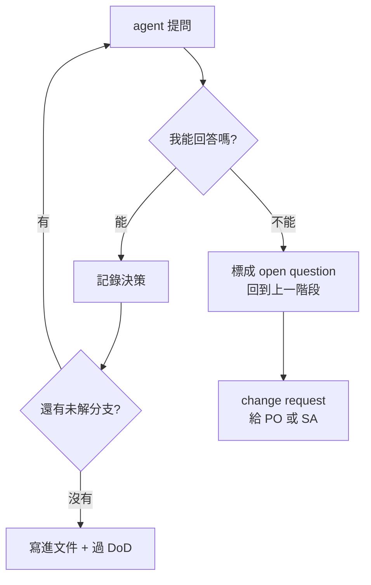

### 2.3 PRD：只談 why / who / what

PRD 刻意**不談實作**。grill 的問題像是：「這是哪個角色的痛？」「現在他們怎麼繞過去？」「上線三個月後用什麼數字判斷成功？」。PRD 交給 SA review。

### 2.4 SA：Event Storming → User Story → AC

SA 把 PRD 翻成可以測的東西：

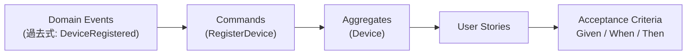

AC 是整條流程的錨點：後面的 integration test、E2E、驗收全部回溯到它。

### 2.5 SD：技術選型與 contract

SD 文件把 SA 的 story 變成可以實作的設計：DDD aggregate、資料模型、happy path 與 error path 的流程圖、API / NATS / protobuf contract、NFR、ADR。SD 依「由哪個微服務實作」分資料夾，並用封閉詞彙的 `tags:` frontmatter 標記，讓總覽地圖可以自動產生。

在 SD 結束前，我會把 **每個 AC 翻成一個會失敗的 integration test**（RED），然後把工作拆成 ≤ 6 小時的 task 推到 ADO 並估工時。

### 2.6 Dev：tutor mode 與 worker mode

進到實作，agent 有兩種模式：

| | worker mode | tutor mode |
|---|---|---|
| 誰寫 code | agent | 我 |
| agent 的角色 | 實作者，我 review 每一步 | 教練，review 與解釋，不接手 |
| 適合 | 熟悉的領域、要趕進度 | 新語言 / 新框架、想真正學會 |

不管哪種模式，每個 task 都跑同一個 TDD 迴圈：

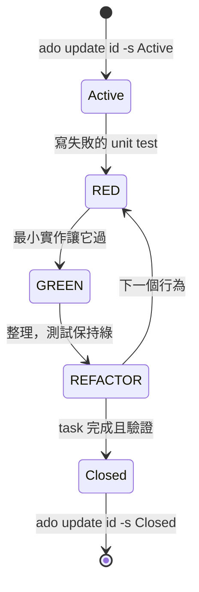

bug fix 一律從**重現 bug 的測試**開始。

### 2.7 E2E：Postman（newman）+ E2E kit

單元測試綠了不代表功能能用。最後一關是 E2E，分兩層：

- **Postman collection + newman**：API 層的回歸測試，團隊共用一個 collection repo，CI 或本機用 `newman run` 跑；
- **E2E kit**：把「在我機器上會過」的 E2E 變成 QA 不用找開發者也能跑的套件。kit 用一份 `kit.yaml` 宣告：
  - 所有變數；
  - 每個前置條件都是一個 **check + 冪等的 bootstrap + 精確的修復指令**；
  - 每個 E2E 步驟都是 **do → observe → expect**，觀察管道可以是 container log、REST、NATS、檔案、process 或 Postman。

kit 最重要的設計是區分兩種失敗：

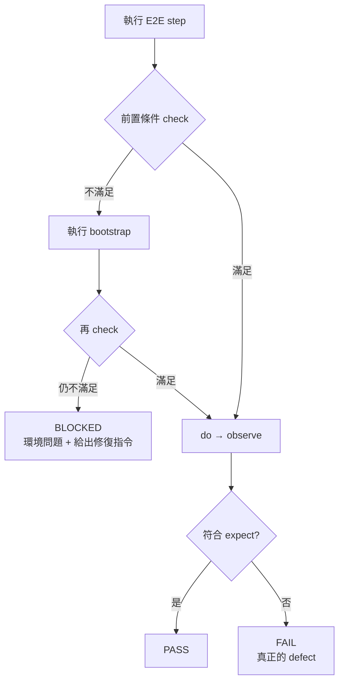

**BLOCKED** 是環境的問題（服務沒起來、憑證過期），**FAIL** 才是程式的 bug。QA 不再需要判斷「是我環境沒弄好，還是真的壞了」。

### 2.8 一條指令走完：`/dev`

上面這些階段被包成四個 stage skill，入口只有一個 `/dev`。它讀取 feature 的進度檔，判斷現在在哪個 stage，然後載入對應的 skill：

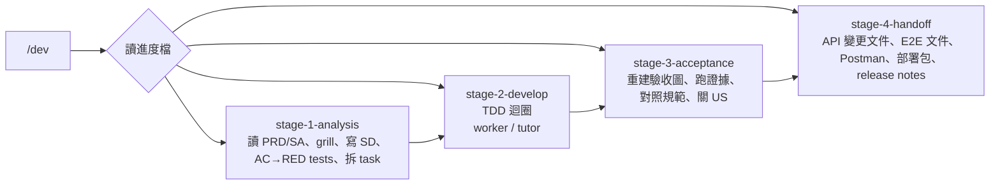

---

## 3. ado：在終端機裡做專案管理

### 3.1 為什麼自己寫一個 CLI

Azure DevOps 的網頁功能完整，但每次切過去都打斷思考；官方 `az` CLI 又太通用，對 agent 來說參數太多、輸出太雜。所以我寫了 `ado`：一個 Go 寫的輕量 CLI + TUI，指令設計成**人和 agent 都好用**。

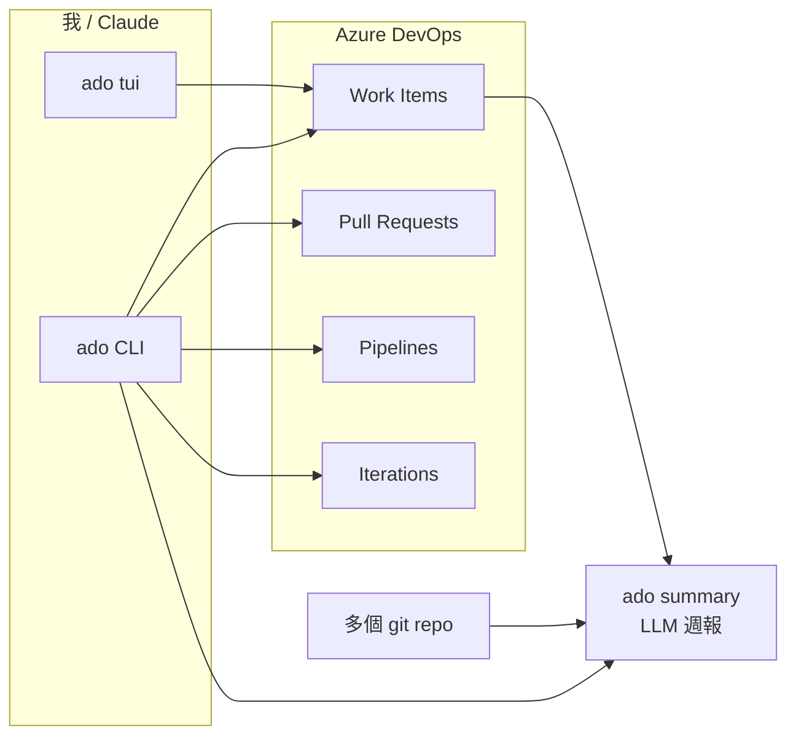

### 3.2 對應到協作的四件事

| 需求 | 指令 |
|---|---|
| **專案管理**：建立 / 拆解工作 | `ado new "實作新功能" --est 8 --parent <story>`、`ado update <id> --parent ...` |
| **時間管理**：估時與剩餘工時 | `ado update <id> --est 4 --remaining 2`、`ado move <id> --current`（搬到本 sprint） |
| **進度追蹤**：狀態與查詢 | `ado update <id> -s Active / Closed`、`ado query`、`ado search --mine` |
| **協作**：PR 與 review | `ado pr "<title>" -r <reviewer> -d "$(cat pr.md)"`、`ado pr --vote <id> --as approve` |
| **回報**：週報 | `ado summary -d 7`（掃 commit + work item，交給 LLM 寫摘要） |

### 3.3 Work item 的生命週期

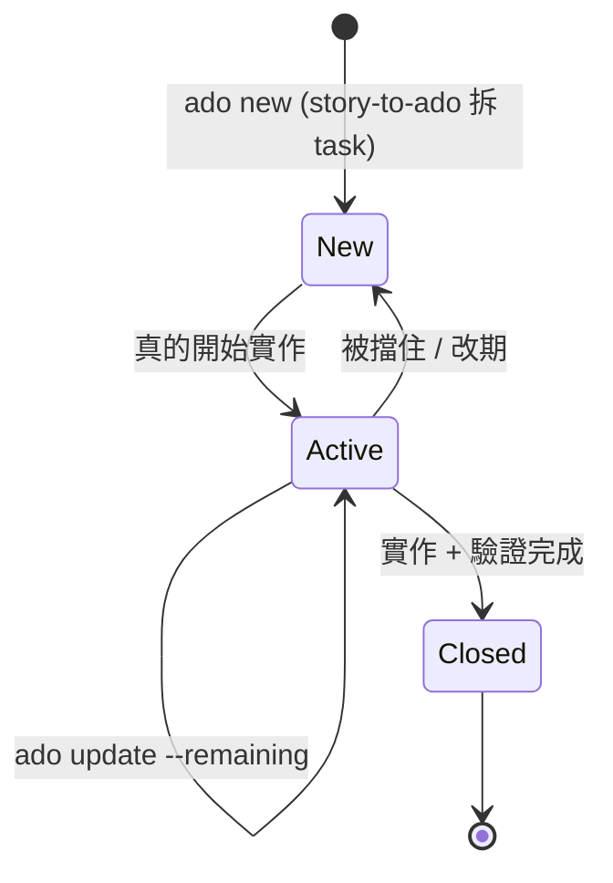

幾個我踩過坑後定下的規則：

- **只在真正動手時才設 Active**，查詢或討論不算；
- 關閉時**不帶 `--remaining`**，讓流程規則自己清空（帶 `0` 反而會被拒絕）；
- PR 一律 noFastForward 合併，**不用 `--auto-complete`**（它會 squash）。

### 3.4 工具壞了就修工具

`ado` 是我們自己的工具，所以遇到缺功能時：**修在工具裡、先寫重現測試**，而不是在 skill 裡偷偷改用 `az` 或 raw REST 繞過。真的不得不臨時繞過時，記到 `tool-gaps.md`，之後補上。這讓工具越用越完整，skill 也保持乾淨。

---

## 4. kube：測試環境的部署與回滾

### 4.1 目標

在 k3s 測試環境上，我想要：一條指令從 repo 到 rollout、失敗自動回滾、能看資源用量，而且**筆電上不需要放 kubeconfig**。

### 4.2 部署管線

`kube` 是一個 k9s 風格的多主機 TUI + CLI，所有叢集操作都走 ssh（ControlMaster 多工連線）：

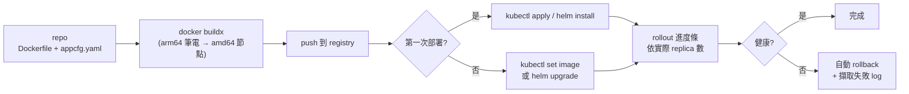

CLI 模式：

```bash
kube ctx ls                  # 列出伺服器
kube ctx select <server>     # 選目標
kube deploy .                # 部署目前 repo
kube deploy --ref feature/x  # 不 checkout，直接部署某個 branch（clean export，跟 CI 一樣）
kube deploy --mode image .   # 只換 image（純程式變更）
kube deploy --mode full .    # helm upgrade + db migrator
```

### 4.3 資源管理與安全閘

| 功能 | 按鍵 / 指令 |
|---|---|
| 狀態 / describe / 跟 log | `s` / `i` / `l` |
| 資源用量（top） | `u` |
| 網路（svc） | `k` |
| 暫時開 Swagger（切 NodePort，離開自動還原） | `w` |
| 設定中心：列出 / 編輯服務設定 | `E` / `e` |
| Guided mode：列出每個動作背後的真實指令 | `g` |

所有寫入動作都有確認視窗；`kube-system` 等受保護 namespace 完全鎖住寫入。

### 4.4 和 Claude 的整合

`ship-to-k3s` skill 把上面的流程包起來：「build、push、deploy 到 dev cluster」一句話就能跑完。目標主機在 skill 裡只寫 `{{DEV_K3S_HOST}}` 佔位符，真實值從 `local.toml` 取，所以 skill 本身可以安心進版本控制、甚至分享給團隊。

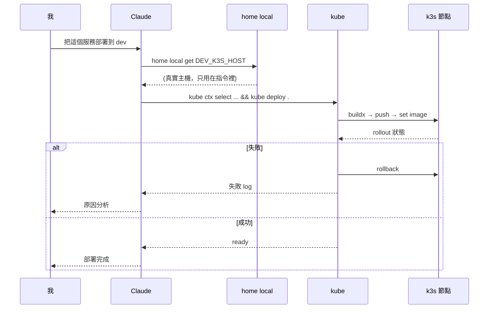

---

## 5. claude 與 claudep：公司與個人的 agent 分離

### 5.1 問題

同一台筆電上，我有公司帳號也有個人帳號。如果共用同一個 `~/.claude`：登入狀態、對話歷史、memory、plugin 全部混在一起，公司的 memory 可能出現在個人專案的 context 裡。

### 5.2 解法：`CLAUDE_CONFIG_DIR` + alias

Claude Code 支援用 `CLAUDE_CONFIG_DIR` 指定設定目錄。在 `~/.zshrc` 加一行：

```bash
alias claudep='CLAUDE_CONFIG_DIR="$HOME/.claude-personal" claude'
```

- `claude` → `~/.claude`（公司帳號）
- `claudep` → `~/.claude-personal`（個人帳號）

兩者各自擁有獨立的登入、history、sessions、memory 與 plugin。

### 5.3 共用 skills，不共用身分

但我不想維護兩份 skills。所以 home repo 有一個 `global/profiles.toml`：

```toml
mirrors = [
  "~/.claude-personal",   # `claudep` alias in ~/.zshrc
]
```

`home link` 會把 `~/.claude/skills` 裡的每個 skill 也 symlink 到 `~/.claude-personal/skills`（帳號綁定的目錄除外）。

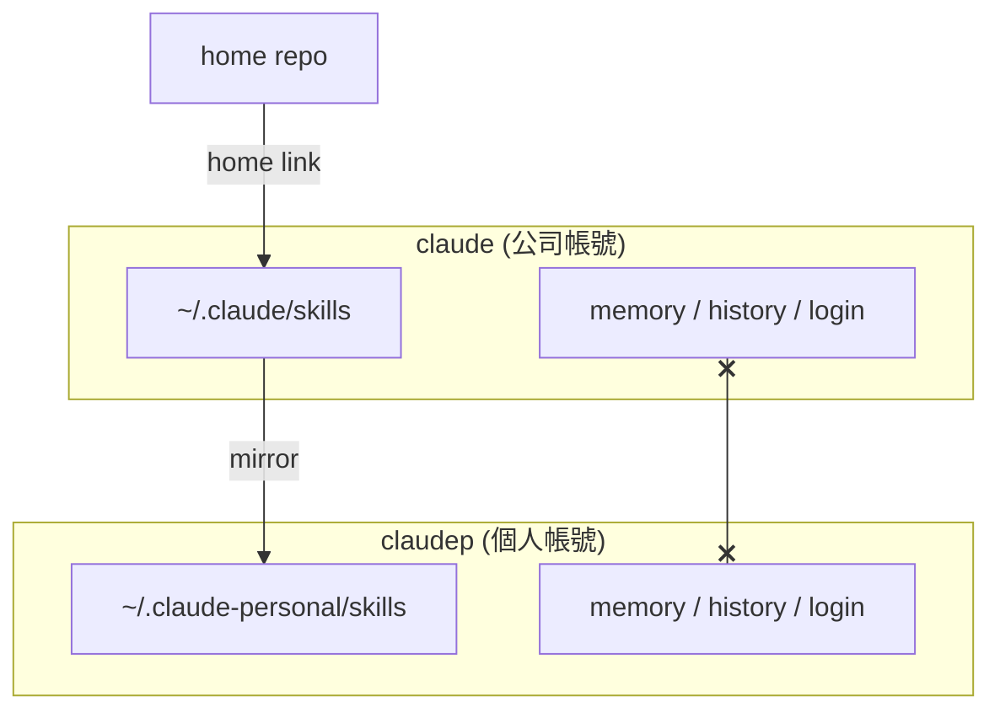

**分離的不是 skill，而是身分與記憶**。真正的情境隔離則靠第 1 節的目錄規則：不管用哪個帳號，在 `~/private` 底下就只會載入個人規則，work 規則明確寫著「不准把公司的 code、wiki 文字、主機名帶進個人專案或公開服務」。

| 維度 | 靠什麼隔離 |
|---|---|
| 帳號、登入、計費 | `claude` vs `claudep`（`CLAUDE_CONFIG_DIR`） |
| memory、history | 同上，各自的 config dir |
| 規則（CLAUDE.md） | 工作目錄往上找（`~/work` vs `~/private`） |
| skills | 共用（home repo 鏡像到兩邊），但 work skill 只在 work 目錄有意義 |
| 機密值 | `local.toml` + `{{KEY}}` + pre-commit 掃描 |

---

## 6. 上線之後：Grafana 與 devcontainer

### 6.1 Monitoring 與 metrics

服務上線後，觀測分三條線，最後都收斂到 Grafana：

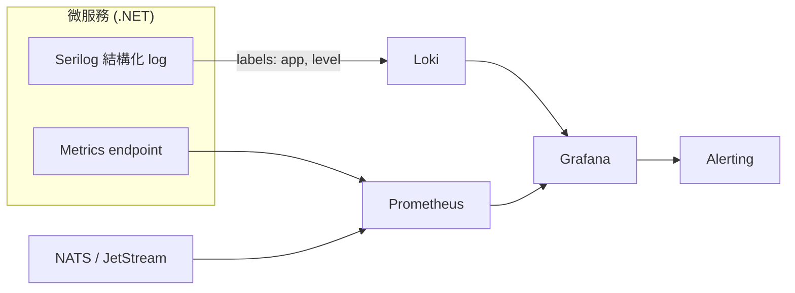

- **Logs**：Serilog 開發時寫 console，上線後寫到 Grafana Loki，用 `AppName`、`Level` 當 label，Grafana 裡可以依服務 / 等級篩選；
- **Metrics**：系統（CPU、記憶體、磁碟）、應用（request、error、指令執行時間）、訊息（NATS stream lag、consumer）、業務（指令數、telemetry 量）四類 dashboard；
- **Alerting**：error rate、stream lag 超過門檻時告警。

E2E kit 的 observe 步驟也能直接看 container log，所以「測試時看到的訊號」和「上線後監控的訊號」是同一套。

### 6.2 devcontainer：一致的開發環境

每個服務 repo 都有 `.devcontainer/`：

- 固定的 SDK image（例如 .NET 8）、formatter、docker-in-docker；
- `docker-compose.yml` 可以一起帶起依賴（資料庫、NATS），註解掉就用外部的；
- 統一的 VS Code extension 與 solution 設定。

好處是：新同事、QA、甚至 agent 自己，都在一樣的環境裡 build 和跑測試，「在我機器上可以」的問題大幅減少，也讓 E2E kit 的前置條件更容易被 bootstrap。

---

## 7. 實戰範例：裝置流量暴增，live stream 變慢

前面講的都是框架，這一節用一個情境從頭走到尾。情境是虛構的，數字只是示意，但流程就是我平常實際在跑的樣子。

> **起點（一句話的需求）**：有裝置的流量大量增加，伺服器 loading 變大、live stream 變慢，我們需要優化。

這句話聽起來很清楚，但如果直接交給 agent「幫我優化」，它很可能會加 cache、調 thread pool、或者直接說「加機器」。每一個都可能有用，也可能完全打錯地方。所以我們從 PRD 開始。

### 7.1 PRD：grill-me 把「變慢」問清楚

我用 `grill-me` 讓 agent 扮演挑剔的 reviewer。幾輪對話的重點節錄：

| agent 追問 | 我的回答（決策） |
|---|---|
| 「變慢」是誰感受到的？ | 在 dashboard 上看即時畫面的維運人員 |
| 慢要怎麼量？ | 從裝置送出到畫面更新的端到端延遲，看 p95 |
| 現在多少？目標多少？ | 現在 p95 約 4 秒；目標在 3 倍裝置量下 p95 < 1 秒 |
| 所有資料都要即時嗎？ | 不用。即時畫面只需要最新值；**歷史資料一筆都不能少** |
| 流量增加是暫時的還是常態？ | 常態，未來還會再成長 |
| 有什麼不能動？ | 裝置端韌體不改、現有對外 API 不能 breaking |
| 不做會怎樣？ | 維運人員看到的是舊資料，告警判斷會延遲 |

grill 的價值在第四題：**「即時」和「完整」其實是兩個需求**。如果沒問出這個，後面的設計很可能為了即時而犧牲完整，或者為了完整而永遠快不起來。

PRD 的結論：

- **Why**：維運人員依賴即時畫面做判斷，延遲讓判斷失準；
- **Who**：維運人員（看即時）、資料分析（看歷史）；
- **What**：3 倍裝置量下，即時畫面 p95 < 1 秒，歷史資料零遺失，對外 API 不變；
- **Out of scope**：裝置韌體、UI 重新設計。

### 7.2 SA：Event Storming 找出熱點

SA 階段先畫出 domain event，從裝置送資料開始往下追：

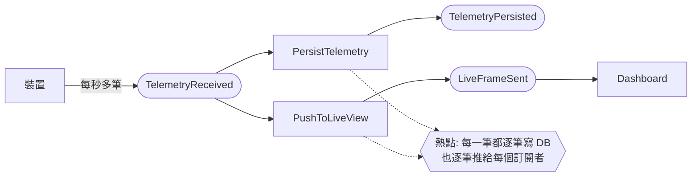

Event storming 讓問題變得具體：**每一筆 telemetry 都走同一條路**，既逐筆寫資料庫，又逐筆推給每一個正在看畫面的人。裝置量變 3 倍，這兩條路的工作量都直接變 3 倍，而且互相搶資源。

拆成 User Story 與 AC：

**US-1 即時畫面不受流量影響**
> 身為維運人員，我希望在裝置量增加時，即時畫面仍能在 1 秒內更新，以便及時判斷狀況。

```gherkin
Scenario: 高流量下即時畫面延遲
  Given 3 倍於現況的裝置同時送資料
  When 維運人員開啟某台裝置的即時畫面
  Then 畫面更新的端到端延遲 p95 < 1 秒

Scenario: 即時畫面只送最新值
  Given 某裝置在 200ms 內送出 10 筆資料
  When 即時推送視窗結束
  Then 訂閱者只收到 1 個 frame
  And 該 frame 的值等於最後一筆
```

**US-2 歷史資料零遺失**
> 身為資料分析人員，我希望所有原始資料都被保存，即使即時畫面做了取樣。

```gherkin
Scenario: 取樣不影響保存
  Given 某裝置送出 1000 筆資料
  When 即時畫面只推送了其中一部分
  Then 資料庫中該裝置仍有 1000 筆
```

**US-3 可觀測**
> 身為維運人員，我希望看得到 ingest 速率、即時延遲與積壓量，以便在惡化前發現。

AC 在這裡就是後面所有測試的錨點：US-1 的兩個 scenario 會變成 integration test 與 E2E，US-2 是資料完整性測試，US-3 是 Grafana panel。

### 7.3 SD：grill-me 技術選型

SD 階段 grill 的是「有哪些做法、為什麼選這個」。agent 會逐一挑戰每個選項：

| 選項 | agent 的挑戰 | 決策 |
|---|---|---|
| A. 直接加機器（水平擴展） | 3 倍流量就要 3 倍成本，下次再成長又要再加；而且逐筆推送的訂閱者 fan-out 不會因為加機器變少 | 保留作為後手，不是主解 |
| B. 加 cache | 即時資料每秒都在變，cache 命中率很低 | 不採用 |
| C. **拆開兩條路徑**：保存走批次寫入，即時走取樣（latest-value-wins） | 對應 PRD「即時」與「完整」是兩個需求；要確認取樣不會漏掉告警判斷需要的值 | **採用** |
| D. 改用另一套 message broker | 遷移成本高，現有 broker 的能力尚未用盡 | 不採用 |

選 C 之後，再 grill 細節：

- 取樣視窗多長？→ 200ms（即時畫面每秒 5 次更新，人眼足夠），可設定；
- 告警判斷用即時路徑還是保存路徑？→ 保存路徑，所以取樣不影響告警；
- 批次寫入多大？→ 每 500 筆或每 1 秒，先到先寫；
- 服務掛掉時 buffer 裡的資料怎麼辦？→ 保存路徑在 ack 之前不丟訊息，靠 broker 的 at-least-once 重送，寫入需冪等。

設計後的資料流：

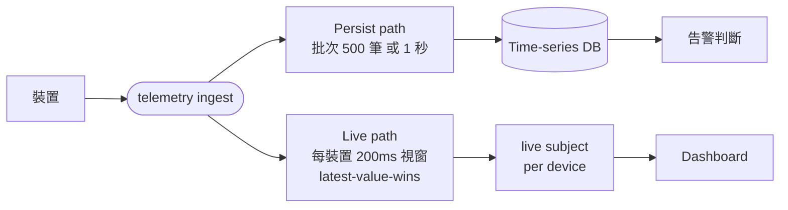

Contract 與 interface（SD 的重點是**先定介面再實作**）：

```csharp
// Domain: 對一台裝置在一個視窗內的資料做合併，只留最新值
public interface ILiveFrameCoalescer
{
    void Offer(TelemetrySample sample);
    IReadOnlyList<LiveFrame> Flush(DateTimeOffset windowEnd);
}

// Infrastructure: 批次寫入，必須冪等（依 deviceId + timestamp 去重）
public interface ITelemetryBatchWriter
{
    Task WriteAsync(IReadOnlyList<TelemetrySample> batch, CancellationToken ct);
}
```

對外 API 不變；新增的只有內部的 live subject，所以向下相容的推論是：舊的 UI 若仍訂閱原本的逐筆 subject，在過渡期照常運作（雙發一段時間後再移除）。

ADR 記錄一行結論：**「即時與保存分離，即時走 latest-value-wins 取樣；不以水平擴展作為主要解法。」**

### 7.4 拆 task 與估時（ado）

`story-to-ado` 把 SD 拆成 ≤ 6 小時的 task 推上 ADO：

| Task | 估時 |
|---|---|
| AC → 失敗的 integration test（US-1、US-2） | 4h |
| `LiveFrameCoalescer` domain + unit tests | 4h |
| `TelemetryBatchWriter` 批次 + 冪等寫入 | 6h |
| Ingest 分流到兩條路徑 + 雙發過渡 | 5h |
| Metrics：ingest rate、live latency、coalesce ratio、batch lag | 3h |
| E2E kit + 壓測腳本 | 5h |

```bash
ado new "LiveFrameCoalescer domain + unit tests" --est 4 --parent <US-1>
ado move <task-id> --current
ado update <task-id> -s Active     # 真的開始寫才設 Active
```

### 7.5 Dev：TDD 從 AC 開始

先把 US-1 的第二個 scenario 寫成會失敗的測試（RED）：

```csharp
[Fact]
public void Flush_emits_only_the_latest_sample_per_device_in_a_window()
{
    var coalescer = new LiveFrameCoalescer();
    var t0 = DateTimeOffset.Parse("2026-01-01T00:00:00Z");

    for (var i = 0; i < 10; i++)
        coalescer.Offer(new TelemetrySample("dev-1", t0.AddMilliseconds(i * 20), value: i));

    var frames = coalescer.Flush(t0.AddMilliseconds(200));

    frames.Count.ShouldBe(1);
    frames[0].Value.ShouldBe(9);
}
```

然後最小實作讓它變綠（GREEN），再補邊界情況：多台裝置互不影響、空視窗不送 frame、遲到的舊資料不覆蓋新值。每個邊界都是先 RED 再 GREEN。

這裡選 worker mode 還是 tutor mode 看情況：coalescer 是純 domain 邏輯、規則清楚，適合 worker mode 讓 agent 寫、我 review；批次寫入的冪等與重送語意比較微妙，我會切 tutor mode 自己寫，讓 agent 挑毛病。

### 7.6 E2E：證明 3 倍流量下真的達標

unit test 證明邏輯對，但 PRD 的目標是「3 倍流量下 p95 < 1 秒」，這只有 E2E 能證明。kit 的寫法（節錄）：

```yaml
prerequisites:
  - id: broker-up
    check: broker health endpoint returns ok
    bootstrap: docker compose up -d broker
    fix: "檢查 broker container log，確認 port 未被占用"
  - id: simulator-ready
    check: device simulator 可以連線
    bootstrap: 啟動 simulator，裝置數 = baseline x 3

steps:
  - id: E2E-1.1
    do: simulator 以 3 倍裝置量持續送資料 5 分鐘
    observe: metrics endpoint 的 live_latency_seconds p95
    expect: "< 1.0"
  - id: E2E-1.2
    do: 單一裝置在 200ms 內送 10 筆
    observe: 訂閱該裝置 live subject 收到的 frame
    expect: 1 個 frame，值為最後一筆
  - id: E2E-2.1
    do: simulator 送出固定 10000 筆後停止
    observe: 資料庫該批裝置的筆數
    expect: "= 10000"
```

QA 跑起來時：

- broker 沒起來 → **BLOCKED**，並印出 fix 指令，不是 bug；
- p95 是 1.4 秒 → **FAIL**，回到 Dev；
- 全部 PASS → 進入部署。

API 層的回歸（確認對外 API 沒被破壞）交給既有的 Postman collection，用 `newman run` 一起跑。

### 7.7 kube：部署到測試環境，壞了自動回滾

```bash
kube ctx select <dev-server>
kube deploy --ref feature/<story>_<initials>_live-coalescing
```

部署時 rollout 進度條依實際 replica 數更新。如果新版本的 health check 沒過（例如批次寫入連不上資料庫），kube 自動 rollback 並把失敗 log 帶回來，Claude 直接拿 log 分析原因，不用我手動 `kubectl logs`。

部署完在測試環境再跑一次 E2E kit，這次 simulator 對著測試環境打。

### 7.8 Grafana：上線前後對照

US-3 的 AC 落在一個 dashboard 上：

| Panel | 意義 | 告警門檻（示意） |
|---|---|---|
| Ingest rate (msg/s) | 裝置流量 | — |
| Live latency p95 | US-1 的核心指標 | > 1s 持續 5 分鐘 |
| Coalesce ratio | 收到幾筆才送出一個 frame，代表取樣省下多少工作 | — |
| Batch write lag | 保存路徑積壓量 | > 10s |
| CPU / memory | 伺服器 loading | > 80% |

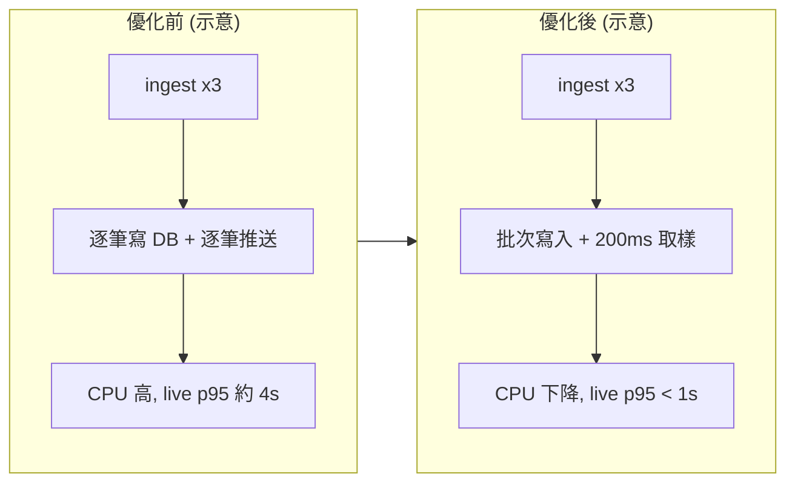

最後 `stage-4-handoff` 產出 API 變更文件（這次只有新增的內部 subject）、E2E 文件、部署包與 release notes；PR 用 feature 格式（Summary / What / Backward compatibility / Tests / Note），Tests 一欄直接貼 RED → GREEN 的證據與 E2E 結果。

### 7.9 回頭看這個範例

| 階段 | 如果跳過會怎樣 |
|---|---|
| PRD grill | 不會發現「即時」與「完整」是兩件事，可能為了速度丟資料 |
| SA event storming | 只會看到「慢」，看不到是逐筆 fan-out 造成的 |
| SD grill | 很可能直接選「加機器」，成本隨流量線性成長 |
| AC → RED test | 優化做完不知道有沒有達標，只能「感覺變快了」 |
| E2E kit | QA 分不清是環境問題還是真的沒達標 |
| Grafana | 上線後下一次流量成長，又要等使用者抱怨才知道 |

一句話的需求，經過五個階段，變成了一個可驗證、可回滾、可觀測的改動。這就是「先想清楚再動工」實際的樣子。

---

## 8. 總結：把整條線串起來

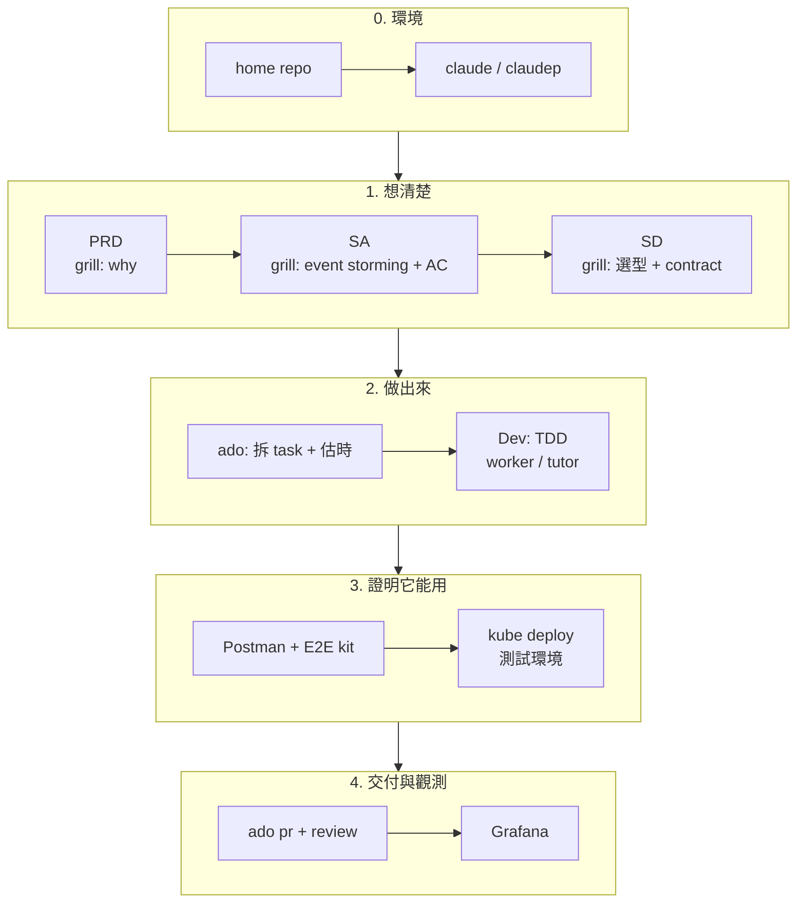

回頭看，這整套系統其實只在做三件事：

1. **單一來源**：規則、skill、路徑、機密各只有一個家（home repo、`projects.toml`、`local.toml`），其他地方都是 link 或佔位符；
2. **先對齊再動手**：用 `grill-me` 在每個階段把假設逼出來，用 AC 把後面所有測試錨定住；
3. **工具化重複的事**：專案管理交給 `ado`、部署交給 `kube`、E2E 交給 kit，壞了就修工具本身，不在 skill 裡打補丁。

AI agent 的能力每幾個月就跳一級，但「先想清楚、留下證據、別讓設定散掉」這幾件事，大概不會過時。
