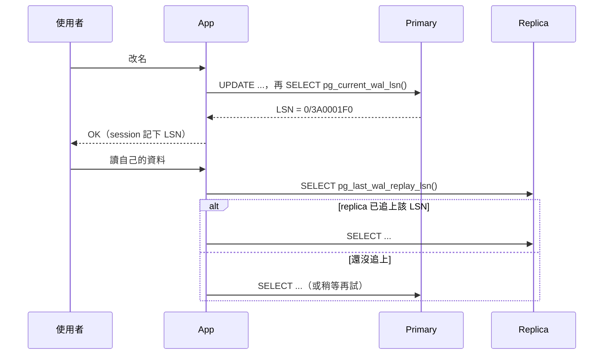
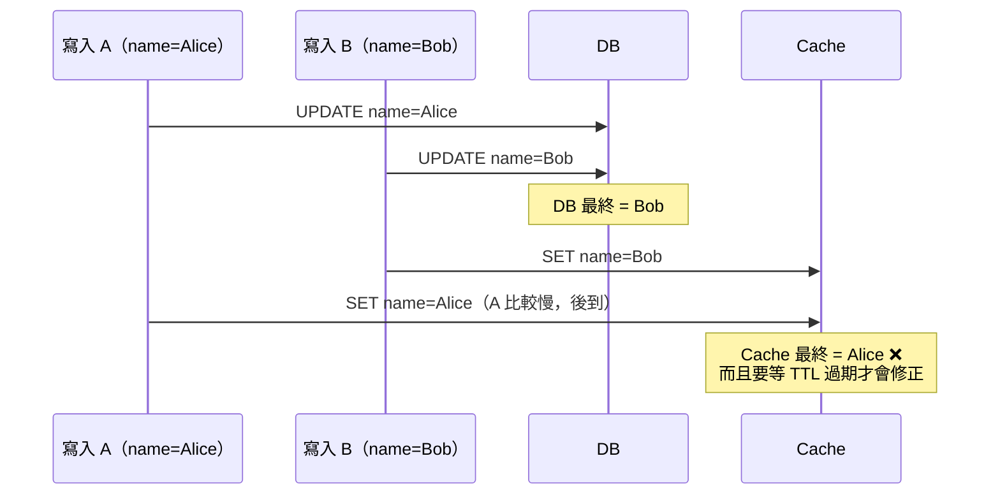
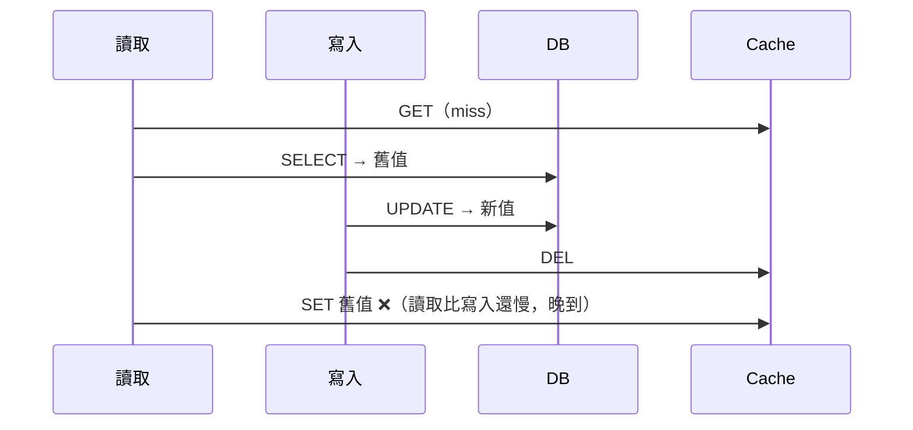
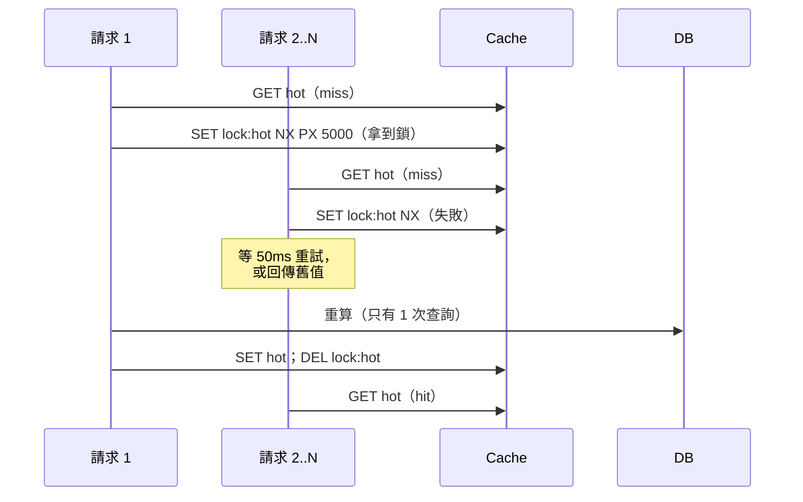
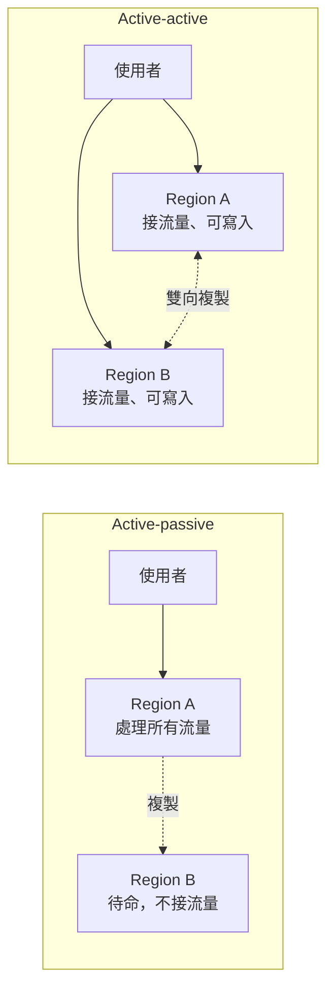
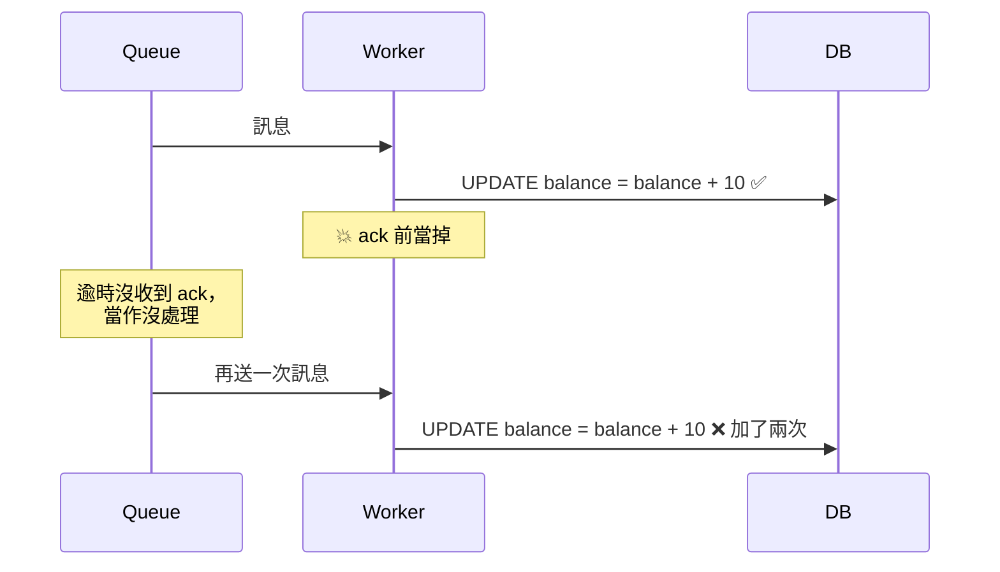
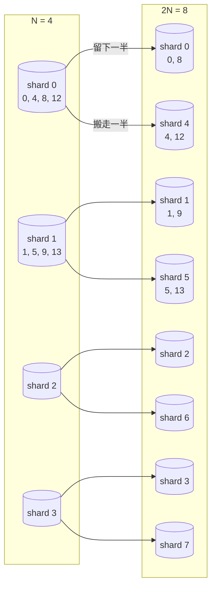
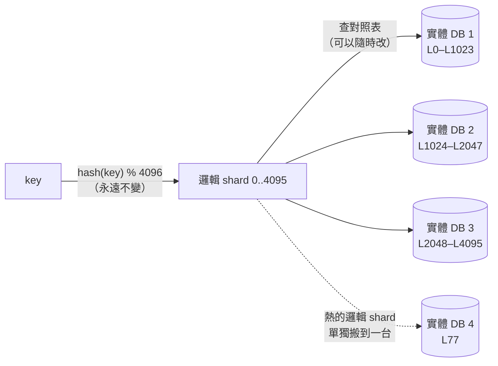
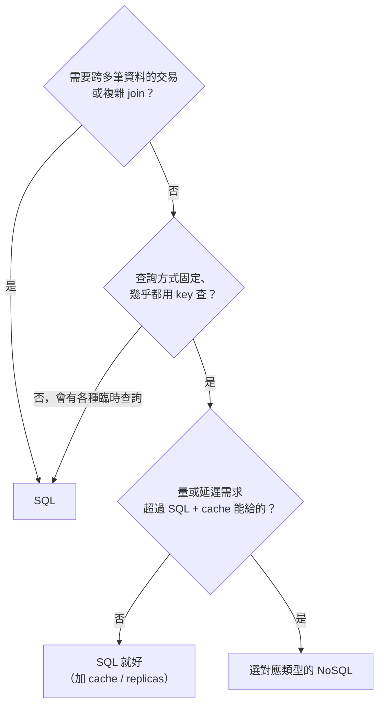

> 本篇是 [Lesson 1：從零擴展到百萬使用者](/posts/system-design/lesson-01-scale-from-zero) 的延伸。
> 讀完那章後我對其中幾個「一句帶過」的點還不夠清楚，這裡逐題拆開。

## 1. Replication lag 實務上怎麼解

先釐清：**lag 本身消不掉**（非同步複製就是會落後），能做的是「讓需要新資料的讀取不要打到落後的 replica」。
依「誰需要看到新資料」分成幾種一致性需求，解法也不同：

| 需求 | 意思 | 常見解法 |
|------|------|----------|
| Read-your-writes | 我剛寫的，我自己一定要看得到 | 寫後一段時間讀 primary；帶 LSN／GTID 等 replica 追上 |
| Monotonic reads | 不能先看到新值、再重新整理又看到舊值 | 同一個使用者固定讀同一台 replica |
| 關鍵讀取強一致 | 付款、庫存、權限檢查 | 直接讀 primary，或同步複製 |
| 整體不能太舊 | 所有人都不想看到過期太久的資料 | 依 lag 剔除 replica、監控 lag |

### 1a. 寫入後一段時間黏在 primary

最便宜、最常見。寫入成功後在 session 或 cookie 記下「最後寫入時間」，之後 N 秒內這個使用者的讀取都走 primary。

- Rails 6 起內建這個機制（automatic database role switching）：`database_selector` 的 `delay` 預設 2 秒，
  寫入後 2 秒內的讀取都送 primary。
- 缺點：N 是猜的，lag 超過 N 就破功；而且只保護「自己」，別人仍可能讀到舊值（通常可以接受）。
- 變形：**自己的資料一律讀 primary**（例如個人設定頁），別人的資料才讀 replica。

### 1b. 帶著寫入位置去讀（LSN / GTID）

精確版。寫入後拿到 primary 的日誌位置，讀取時只選「已經套用到這個位置」的 replica。



- Postgres：primary 用 `pg_current_wal_lsn()`，replica 用 `pg_last_wal_replay_lsn()` 比較。
- MySQL：GTID，replica 端用 `WAIT_FOR_EXECUTED_GTID_SET()` 等到追上；ProxySQL 也能依 GTID 做 causal read。
- 資料庫內建的版本：MongoDB 的 causally consistent session、Azure Cosmos DB 的 session consistency（session token），
  本質都是「client 帶著自己看過的最新位置」。

### 1c. 同步或半同步複製

讓 primary 的 commit 等 replica。

- Postgres `synchronous_commit = remote_apply`：commit 要等同步 standby **套用完**才回應，所以讀那台一定看得到。
- MySQL semi-sync：等 replica **收到**（寫進 relay log），不保證已套用，所以防的是資料遺失，不完全防 lag。
- 代價：每次寫入多一個網路來回，同步的 replica 慢或掛掉會拖累寫入。通常只對一台 replica 做同步，其他保持非同步。

### 1d. 依 lag 把 replica 踢出去

Proxy 或 LB 定期量每台 replica 的 lag，超過門檻就暫時不分讀取給它
（ProxySQL 的 `max_replication_lag`、pgpool-II 的 `delay_threshold`）。
這不保證 read-your-writes，但能防止「某台卡住、落後好幾分鐘」這種最糟情況。

### 1e. 產品面的解法

- **Optimistic UI**：前端直接顯示使用者剛輸入的值，不重新讀伺服器。很多「改完看到舊的」根本不必走到 DB。
- 接受最終一致：按讚數、瀏覽數晚幾秒沒人在意，別為它付出 primary 的負載。

### 面試回答順序

先說「這是 read-your-writes 問題」，再給便宜解法（寫後 N 秒讀 primary），再給精確解法（LSN / GTID），
最後補一句「還要確認 cache 有沒有被失效，否則看起來是同一個 bug」。

## 2. 為什麼 cache 是「更新 DB 時刪除」，而不是「更新 DB 時寫入」

Cache-aside 的規則是：**寫入時先更新 DB、再 `DEL` cache；讀取 miss 時才從 DB 回填。**
不在寫入時 `SET` 新值，有四個理由。

### 理由 1：並行寫入會把舊值留在 cache



DB 的寫入順序和 cache 的寫入順序**沒有任何機制保證一致**（網路、GC、執行緒排程都可能讓 A 晚到）。
改成刪除就沒這問題：不管兩個 `DEL` 誰先誰後，結果都是「cache 裡沒有」，下次讀取從 DB 拿到 Bob。
**刪除是冪等的、與順序無關**，更新不是。

### 理由 2：cache 的值常常不是「一列資料」

Cache 裡放的常是組合過的結果：使用者 + 他的追蹤數 + 最近三篇貼文，再序列化成 JSON。
寫入端要更新它，就得知道「這次改動會影響哪些 cache key、每個 key 要怎麼重算」，邏輯散落各處。
刪除只要知道 key，重算交給讀取路徑（那裡本來就有完整的組裝邏輯）。

### 理由 3：寫了可能沒人讀

寫多讀少的資料，每次寫都 `SET` 是在浪費 cache 記憶體和網路。Lazy loading 只為「真的有人讀」的資料付錢。

### 理由 4：失敗時比較好補

DB 成功、cache 操作失敗時：`SET` 失敗留下舊值；`DEL` 失敗也留下舊值，但 `DEL` 可以安全地重試任意次
（冪等），也可以丟進 queue 稍後重試。

### 為什麼是「先 DB 後刪除」，不是「先刪除後 DB」？

先刪 cache 的話，刪除和 DB 更新之間有一段空窗：這時來一個讀取，miss 之後讀到 DB 的**舊值**並回填，
cache 又變成舊的，而且會一直待到 TTL 過期。先更新 DB 再刪，這個空窗就小很多。

### 先 DB 後刪除還剩下的洞



發生條件是「一個讀取跨越了整個寫入」，讀取通常比寫入快很多，所以機率低，但在大流量下一定會發生。補法：

- **Lease**（Facebook memcache）：miss 時 cache 發一個 lease token 給讀取者，只有持 token 的人能 `SET`。
  期間如果有 `DEL`，token 就失效，晚到的舊值 `SET` 會被拒絕。
- **延遲雙刪**：寫入後 `DEL`，隔幾百毫秒再 `DEL` 一次，把那個晚到的舊值刪掉。簡單但時間是猜的。
- **用 DB 的變更日誌刪 cache（CDC）**：訂閱 binlog / WAL，資料真的 commit 了才刪對應 key。
  Facebook 在論文中描述的 mcsqueal 就是讀 MySQL commit log 再廣播失效。好處是應用程式忘了刪也沒關係。
- **短 TTL 兜底**：任何漏網之魚最多活一個 TTL。

### 什麼時候「寫入時更新 cache」是對的？

- 寫入路徑被**序列化**了（單一 writer、或用版本號做 `SET if newer`），沒有並行亂序的問題。
- Cache 本身就是資料來源的一部分（write-through / write-behind，由 cache 層負責寫 DB）。
- 計數器這種用原子操作（`INCR`）就能正確累加的值。

## 3. Stampede 怎麼做？TTL 抖動是什麼？

這題其實混了兩個不同的問題，中文圈常用三個名詞區分：

| 名詞 | 英文 | 問題 | 主要解法 |
|------|------|------|----------|
| 快取擊穿 | cache stampede / thundering herd / dog-pile | **一個**熱門 key 過期，大量請求同時 miss | 只讓一個請求重算 |
| 快取雪崩 | cache avalanche | **大量** key 在同一時間過期（或 cache 整個掛掉） | **TTL 抖動**、cache 高可用 |
| 快取穿透 | cache penetration | 查**不存在**的 key，永遠 miss，每次都打 DB | 快取空值、Bloom filter |

### 3a. Stampede 的解法



1. **互斥鎖（mutex / single-flight）**：只有搶到鎖的請求去查 DB，其他人等一下再讀 cache，或先回傳舊值。
   - 分散式：Redis `SET lock:key token NX PX 5000`，鎖一定要有過期時間，避免持鎖者當掉造成死鎖。
   - 單機內：同一個 process 裡的併發請求合併成一次（request coalescing），例如 Go 的 `singleflight`、
     .NET 用 `ConcurrentDictionary<string, Lazy<Task<T>>>`。每台 web server 最多只放一個請求進 DB，
     很多時候這就夠了。
2. **Lease**（Facebook）：同樣是「只發一張許可給一個人」，但做在 cache server 裡。
   論文中他們設定每個 key 每 10 秒最多發一次 lease token，其他人收到「稍等」，短暫等待後重試通常就會命中。
3. **Stale-while-revalidate**：值裡面另外存一個「邏輯過期時間」，實體 TTL 設長一點。
   過了邏輯過期時間，第一個看到的人觸發背景重算，**所有人照樣先拿舊值**。延遲最穩，代價是會短暫回傳舊資料。
   HTTP 的 `Cache-Control: stale-while-revalidate` 是同一個想法。
4. **提前、機率性地重算（XFetch）**：快過期時，每個請求以一個隨過期時間逼近而升高的機率「自願」提前重算，
   讓重算在過期前就被某一個請求完成。出自 Vattani 等人的 *Optimal Probabilistic Cache Stampede Prevention*（VLDB 2015）：

   ```text
   if now - delta * beta * ln(rand()) >= expiry:   # rand() in (0,1], ln 為負，所以是往後推
       recompute
   ```

   `delta` 是重算所需時間，`beta` 預設 1，越大越積極。不用鎖，適合重算很貴的 key。
5. **永不過期 + 背景刷新**：已知的超熱 key（首頁、排行榜）不設 TTL，由排程工作定期重算覆寫。

### 3b. TTL 抖動（jitter）

**抖動是給 TTL 加一點隨機數**，讓 key 不要在同一秒一起過期：

```csharp
var ttl = TimeSpan.FromSeconds(600 + Random.Shared.Next(0, 60)); // 600–660 秒
await cache.StringSetAsync(key, value, ttl);
```

為什麼需要？因為很多 key 是「同一時間」寫進 cache 的：

- 部署後 cache 是空的，前幾分鐘有大量 key 被同時回填；
- 批次工作一次預熱了 10 萬筆；
- 這些 key 全部 `TTL = 600`，於是 10 分鐘後**同一秒一起過期**，DB 瞬間吃下 10 萬個 miss，這就是雪崩。

加上 0–10% 的隨機抖動，過期時間被攤平到一分鐘內，DB 的壓力從一個尖峰變成一段緩坡。
同樣的道理也用在 retry 的 exponential backoff + jitter（避免所有 client 同時重試）。

注意抖動**解不了單一熱 key 的 stampede**：那一個 key 還是會在某個時間點過期，還是要靠 3a 的方法。

## 4. 什麼是跨區 active-active

### Active-passive vs active-active



| | Active-passive | Active-active |
|---|---|---|
| 平常 | 一區服務，另一區待命 | 每一區都在服務真實流量 |
| 故障切換 | 要「升級」待命區，常常是第一次真的上線，容易出事 | 把流量多導一些到健康的區，它本來就在跑 |
| 延遲 | 遠方使用者都繞到主區 | 使用者就近服務 |
| 難點 | 待命區的資料與設定是否真的可用 | **兩邊都能寫，寫入衝突怎麼辦** |
| 容量 | 待命區可以小一點（但切換時要擴） | 每一區都要能吃下其他區失效時轉來的流量（兩區時各跑 ≤ 50%） |

**Active-active 的核心難題是多處寫入。** 常見做法：

1. **依使用者分「主場區」**（最常見）：每個使用者的寫入只送到他的 home region，其他區只有讀取複本。
   嚴格來說是「區域層級的 sharding」，避免了衝突，但跨區使用者的寫入要繞路。
2. **多主寫入 + 衝突解決**：兩邊都直接寫、非同步互相複製，衝突用規則決定：
   - Last-writer-wins：以時間戳為準，後寫的贏（DynamoDB global tables 就是這樣）。簡單，但會默默丟掉一筆寫入。
   - CRDT：設計成「合併順序不影響結果」的資料型別（計數器、集合），Redis Enterprise 的 Active-Active 用這個。
3. **全球一致的資料庫**：Spanner、CockroachDB 用共識協定（Paxos / Raft）跨區寫入。
   不會衝突，但每次寫入都要付跨區來回的延遲（數十到上百毫秒）。

**Netflix 的例子**：2012 年聖誕夜 AWS US-East-1 的 ELB 故障，當時 Netflix 只靠那一區，於是停擺。
之後他們做成 US-East 與 US-West 的 active-active：資料用 Cassandra 跨區複製（最終一致），
任一區出問題時把流量導到另一區。

面試時一句話版本：*active-active means every region serves live traffic, so failover is just shifting
load; the cost is handling writes in more than one place, either by giving each user a home region or by
resolving conflicts.*

## 5. 「Consumer 必須冪等」是什麼意思？

是，**冪等 = idempotent**。數學上 `f(f(x)) = f(x)`：**同一個操作做一次和做很多次，結果相同。**

| 冪等 | 不冪等 |
|------|--------|
| `SET balance = 100` | `balance = balance + 10` |
| `DELETE FROM t WHERE id = 1` | `INSERT INTO t ...`（沒有唯一鍵） |
| 把縮圖寫到 `thumb/123.jpg`（覆寫同一個檔） | 寄一封 email |
| HTTP `GET`、`PUT`、`DELETE` | HTTP `POST` |

### 為什麼 consumer 一定會收到重複訊息

大多數 queue（SQS、RabbitMQ、Kafka 的預設用法）保證的是 **at-least-once**：至少送到一次，可能多次。
原因是「處理」和「確認（ack）」是兩個步驟，中間任何地方當掉，queue 都無法知道到底做完沒：



如果改成「先 ack 再處理」，當掉時訊息就**遺失**了（at-most-once）。
在分散式系統中做不到真正的 exactly-once **投遞**，業界的做法是：**at-least-once 投遞 + 冪等的 consumer = 效果上 exactly-once 的處理**。

### 怎麼讓 consumer 冪等

1. **去重表（最通用）**：每則訊息帶唯一 id，處理時在**同一個 DB 交易**裡記下它，唯一鍵擋掉第二次。

   ```sql
   BEGIN;
   INSERT INTO processed_messages (message_id) VALUES ('msg-42')
     ON CONFLICT DO NOTHING;
   -- 影響 0 列：處理過了，ROLLBACK 並 ack
   UPDATE accounts SET balance = balance + 10 WHERE id = 1;
   COMMIT;
   -- 之後才 ack
   ```

   關鍵是「記錄」和「副作用」在同一個交易裡，要嘛都成功、要嘛都沒發生。
2. **把操作改寫成本來就冪等**：`balance + 10` 改成「把第 42 筆交易記錄設為已入帳」；
   縮圖輸出到由輸入決定的固定路徑，重做一次只是覆寫成一樣的檔。
3. **條件更新 / 版本號**：`UPDATE orders SET status = 'paid' WHERE id = 7 AND status = 'pending'`，第二次自然影響 0 列。
4. **無法回滾的外部副作用**（寄信、扣第三方款項）：把 idempotency key 傳給對方。
   Stripe API 的 `Idempotency-Key` header 就是為此設計：同一個 key 重送，Stripe 回傳第一次的結果，不會重複扣款。

同樣的概念也用在 API 設計：client 因為逾時而重試 `POST /payments`，伺服器要靠 idempotency key 認出這是同一筆。

## 6. Resharding 時固定從 N 變 2N，是不是可以減少搬家？

**你的推論是對的。** 用 `shard = key % N`，翻倍成 `key % 2N` 時：

> 原本在 shard `x` 的 key，新的位置只會是 `x` 或 `x + N`。

證明：`key % N = x` 代表 `key = qN + x`。`q` 是偶數時 `key % 2N = x`，`q` 是奇數時 `key % 2N = x + N`。
所以每個舊 shard 剛好「分裂」成兩個，**不會有資料跑到其他不相干的 shard**。



### 搬多少？

| 擴容方式 | 需要搬的資料比例 |
|----------|------------------|
| `% N` → `% (N+1)` | 約 `N / (N+1)`，N = 4 時是 80%，幾乎全搬 |
| `% N` → `% 2N` | **50%**，而且每列只會去一個固定的兄弟 shard |
| Consistent hashing 加一個節點 | 約 `1 / (N+1)` |

50% 看起來還是很多，但翻倍有個更大的實務好處：**搬家可以用整台複製來做，而不是逐列搬**。
把 shard `x+N` 建成 shard `x` 的 replica（完整複製），追上後切換路由，然後兩邊各自刪掉不屬於自己的那一半。
不需要寫逐列搬移的程式，而且切換期間兩邊都有完整資料，比較安全。

### 翻倍的缺點

- **容量是階梯式的**：需要 70 台的量時，只能從 64 跳到 128，一半機器在閒置。
- **熱點不會變好**：名人所在的那個 key 翻倍後還是在同一個 shard，只是那台機器上的「鄰居」少了一半。
- 每次翻倍仍要動到所有 shard。

### 所以你的結論：邏輯 shard 數量要大、對應到少量實體 DB

這正是 Instagram、Pinterest、Notion 的做法，而且它把「翻倍」這招推廣成更彈性的版本：



- **第一層：`key → 邏輯 shard`** 用固定公式，邏輯 shard 數量一開始就開很大（例如 4096），之後永遠不改，所以 key 永遠不會重新 hash。
- **第二層：`邏輯 shard → 實體 DB`** 用一張**對照表**，不用公式。所以：
  - 實體 DB 可以加任意台數，不必翻倍（需要 70 台就開 70 台）；
  - 擴容時搬的是**整個邏輯 shard**（一個 Postgres schema 或一個 MySQL database），可以用 replication 或 dump/restore 整包搬；
  - **某個邏輯 shard 很熱，可以單獨搬到一台機器**，這就是你說的「針對熱點導流」。
- 一開始邏輯 shard 多、實體機器少，每台機器放很多個邏輯 shard，**不用一開始就開很多 DB**。

真實例子：

- **Instagram（2012）**：數千個邏輯 shard，每個是一個 Postgres schema，放在少數幾台實體機上。ID 內嵌邏輯 shard id，所以光看 ID 就知道資料在哪。
- **Pinterest（2015，*Sharding Pinterest: How we scaled our MySQL fleet*）**：4096 個 shard（每個是一個 MySQL database），一開始放在 8 台實體伺服器上，每台數百個；之後靠搬整個 database 到新機器擴容，資料不在 shard 之間移動。
- **Notion（2021 / 2023）**：480 個邏輯 shard 先放在 32 台 Postgres；2023 年再擴到 96 台，邏輯 shard 數量不變，只是重新分配到更多機器。

### 但要分清楚兩種熱點

| 熱點類型 | 例子 | 邏輯 shard 能解嗎？ | 解法 |
|---------|------|-------------------|------|
| **某個 shard 整體偏熱** | 一個 shard 裡剛好有好幾個大戶 | ✅ 把那個邏輯 shard 搬到獨立機器 | 對照表重新分配 |
| **單一 key 超熱** | 一位名人、一則爆紅貼文 | ❌ 一個 key 只會在一個邏輯 shard 裡，搬到哪台都是一台扛 | 讀多：cache、多個讀取 replica；寫多：把 key 拆成 `key#0..key#k` 分散寫入，讀時合併（例如按讚數） |

另外記住 **range-based sharding** 是另一條路：依 key 的範圍切，某段變大或變熱就自動對半切（Bigtable、HBase、CockroachDB 都會自動分裂 range）。
適合需要範圍查詢的資料，但連續遞增的 key（時間戳、自增 id）會讓寫入全部擠到最後一段。

面試時的完整答案：*hash into a large fixed number of logical shards, map logical shards to physical
hosts with a lookup table, and move whole logical shards when you add capacity. Hot shards can get their own
host; a single hot key needs caching or key splitting.*

## 7. SQL vs NoSQL：什麼時候用哪個

先說結論：**預設用 SQL（關聯式資料庫），需要時再用某種具體的 NoSQL 解決某個具體的問題。**
「NoSQL」不是一種資料庫，而是好幾類，各自解不同問題，所以真正的問題是「哪一種 NoSQL、為了哪個存取模式」。

### 選 SQL 的時候

- 資料之間有**關聯**，需要 join（使用者、訂單、商品、評論）。
- 需要**多列 / 多表的交易**：轉帳、下單扣庫存，要嘛全部成功、要嘛全部失敗。
- **查詢方式還不確定**、會有臨時的報表或分析需求。SQL 的強項是「先存下來，之後想怎麼查都可以」。
- 需要資料庫幫你守住約束：外鍵、唯一鍵、`CHECK`。
- 資料量和寫入量還在單台 primary + replicas 撐得住的範圍（Stack Overflow 證明這個範圍很大）。

### 選 NoSQL 的時候（以及選哪一種）

| 類型 | 代表 | 適合 | 典型用途 |
|------|------|------|----------|
| Key-value | Redis、DynamoDB、Memcached | 只用 key 查、要求極低延遲、量極大 | session、cache、購物車、rate limiter 計數 |
| Document | MongoDB、Firestore | 資料是一整包自成一體的物件、schema 常變 | 商品目錄（每類欄位不同）、CMS 內容、使用者設定 |
| Wide-column | Cassandra、ScyllaDB、HBase、Bigtable | 寫入量巨大、依 partition key + 排序鍵查 | 聊天訊息、時間序列、事件 log、IoT telemetry |
| Graph | Neo4j、Neptune | 關係本身就是查詢重點、多跳查詢 | 社交關係推薦、詐欺偵測、知識圖譜 |

共同點：**用查詢方式反推資料結構**。NoSQL 通常要你在建表時就知道「會怎麼查」，
例如 DynamoDB 的 single-table design、Cassandra「一個查詢一張表」。換來的是水平擴展很直接、延遲穩定。
代價是：沒有（或很有限的）join 和跨 partition 交易，新的查詢需求可能要重新建一份資料。

**真實例子：Discord 存訊息。** 2017 年的 *How Discord Stores Billions of Messages* 說明他們把訊息從 MongoDB 搬到 Cassandra：
寫入量大、查詢模式固定（某個頻道、依時間倒序取一段），正好是 wide-column 的強項。
2023 年的 *How Discord Stores Trillions of Messages* 又從 Cassandra 搬到 ScyllaDB，主因是維運與延遲問題。
這是一個「存取模式清楚 + 量巨大 → 選 NoSQL」的典型案例。

### 一個簡單的判斷流程



### 界線正在變模糊

- Postgres 的 `JSONB` 讓 SQL 也能存半結構化資料並建索引，很多「因為 schema 會變」而選 MongoDB 的理由已經不成立。
- **NewSQL**（Spanner、CockroachDB、TiDB）提供 SQL + 交易 + 水平擴展，代價是寫入延遲與成本。
- 實務上常是**混用**（polyglot persistence）：核心交易資料在 Postgres，session 和 cache 在 Redis，訊息或事件在 Cassandra / Kafka。

面試時的說法：*I default to a relational database because the data is relational and I want
transactions; I'd move a specific part to NoSQL when its access pattern is simple key lookups and
its volume or latency needs outgrow what a sharded SQL setup plus cache can give.*
