> 教材：Alex Xu，*System Design Interview*，第 1 章 *Scale from zero to millions of users*。
> 延伸問答（replication lag、cache 一致性、stampede、active-active、冪等、resharding、SQL vs NoSQL）
> 放在 [Lesson 1 延伸：七個追問](/posts/system-design/lesson-01-deep-dive)。

第 1 章本身不是一道面試題，但它幾乎是**每一道題答案的骨架**：面試官說「把它擴展到 1000 萬使用者」時，
期待聽到的就是這一串步驟，而且每一步都要用某個瓶頸來說明理由。
所以我把它當成一條**問題 → 解法 → 新問題**的鏈來讀，而不是一張元件清單。

## 學完這章應該能

- 3 分鐘內從白紙畫出最終架構，並說明每個方塊為什麼存在。
- 對每個元件說出：它消除了哪個瓶頸或單點故障（SPOF），又帶來了什麼新問題。
- 回答常見追問：cache 一致性、replication lag、sticky session、sharding key 怎麼選。

## 1. 演進鏈

每一步之所以存在，都是因為上一版撞牆了。

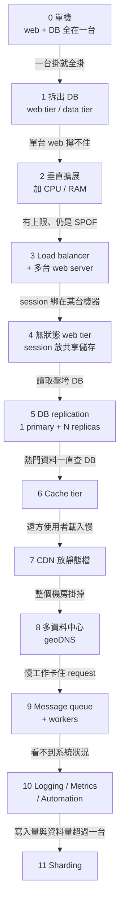

| # | 步驟 | 解決的問題 | 帶來的新問題 |
|---|------|-----------|-------------|
| 0 | 單機（web + DB + 全部） | 還沒有東西要維運 | 一台掛全部掛；web 和 DB 搶 CPU / RAM |
| 1 | 拆出 DB | web 與 DB 可以各自擴展 | 仍然只有一台 web、一台 DB：兩個 SPOF |
| 2 | 垂直擴展 | 快、不用改程式 | 有硬上限、昂貴、仍是 SPOF |
| 3 | Load balancer + N 台 web | web tier 可 failover、可水平擴展 | 存在本機的狀態（session）壞掉；LB 成為新 SPOF |
| 4 | 無狀態 web tier | 任何一台都能服務任何請求；可自動擴縮 | 共享儲存變成關鍵元件 |
| 5 | DB replication | 讀取擴展、DB failover、資料耐久 | Replication lag：讀到舊資料、read-your-writes bug；failover 很難 |
| 6 | Cache | 熱門讀取不再打 DB | Cache 與 DB 一致性、過期瞬間的 stampede、eviction |
| 7 | CDN | 遠方使用者的延遲、分擔 web tier | 成本、失效（invalidation）、TTL 調校 |
| 8 | 多資料中心 | 區域性故障、全球延遲 | 跨區資料同步、每個區域都要部署和測試 |
| 9 | Message queue | 把慢工作移出 request、解耦 | At-least-once 投遞，consumer 必須冪等；要監控 queue 深度 |
| 10 | Logging / metrics / automation | 看不到就修不了 | 維運成本 |
| 11 | Sharding | 寫入量與資料量超過單機 | Resharding、熱點（名人問題）、不能跨 shard join |

書末的總結就是這條鏈的壓縮版：*web tier 無狀態、每一層都有備援、盡量 cache、多資料中心、
靜態檔放 CDN、data tier 用 sharding、拆成獨立服務、監控並自動化。*

### 最終架構（Figure 1-23 簡化）

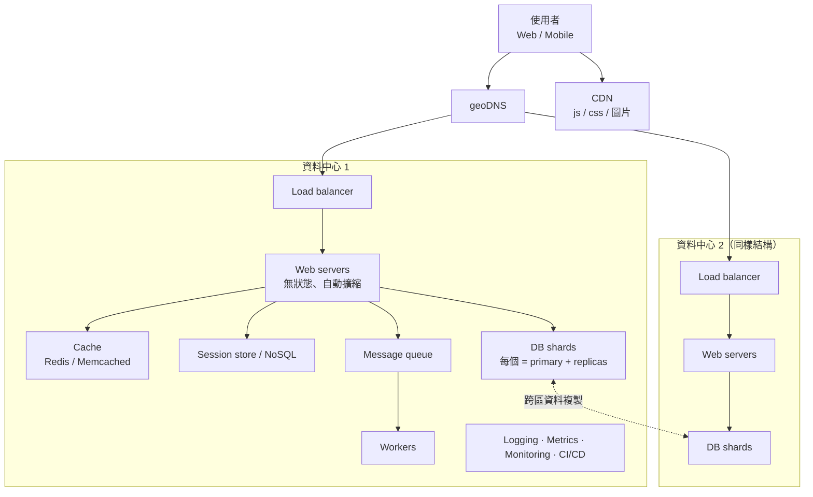

## 2. 各元件與背後的真實系統

### 起點：單機的 request 流程

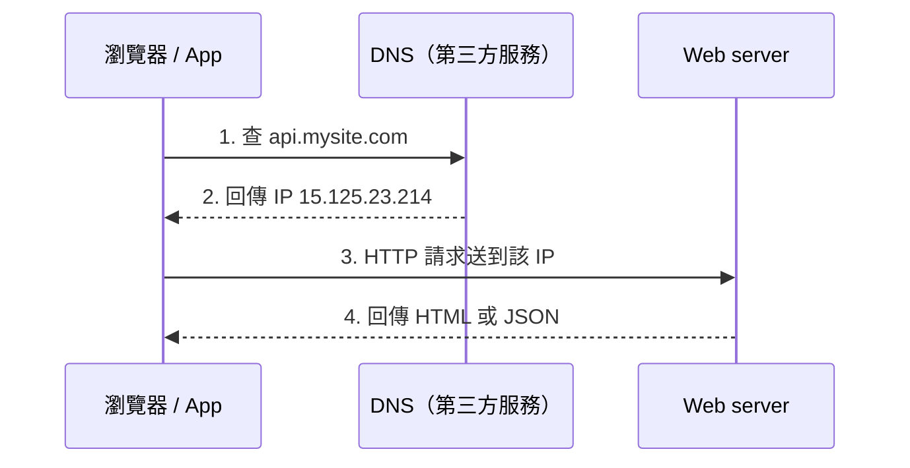

流量來源有兩種：web app（伺服器端語言處理邏輯、HTML/JS 負責呈現）和 mobile app（HTTP + JSON）。

### Web tier：load balancer 與無狀態伺服器

- 使用者連到 LB 的**公開 IP**；web server 只有**私有 IP**，外部連不到。
- 加了 LB 和第二台 web 之後：一台掛了，流量全轉到另一台；流量變大，就往 pool 裡加機器。

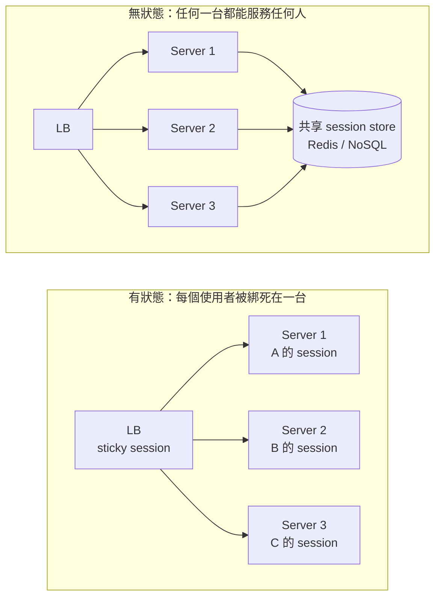

- **有狀態**的伺服器逼你用 **sticky session**：LB 必須把同一個使用者一直送到同一台。
  加減機器時使用者會被搬來搬去、掉 session；一台掛了，上面所有人都被登出。
- **無狀態**：session 放在共享儲存，任何一台都能處理任何請求，自動擴縮就只是「加機器、減機器」。
  這就是 Twelve-Factor App 的 *processes are stateless*。
- 另一條路是把狀態放在 client（JWT 這類簽章 token）：不用查儲存，但很難提前撤銷。
- **真實案例：Stack Overflow，2013。** 每月超過 1000 萬訪客，只用了少數幾台機器：
  HAProxy 做 LB、約 11 台 IIS web server、Redis，以及 384 GB RAM 的 SQL Server
  （Nick Craver，*What it takes to run Stack Overflow*）。「**垂直擴展可以走很遠**」，
  面試時先講這點，再談 sharding。

### Data tier：replication

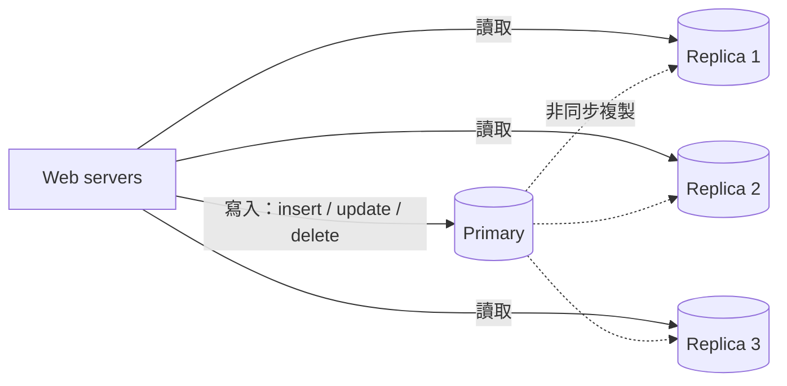

- Primary 負責寫，replica 負責讀。多數應用讀遠多於寫，所以 replica 通常有好幾台。
- 好處：效能（讀取平行化）、可靠性（一台被天災毀掉資料還在）、高可用（一台離線還能讀別台）。
- Replica 掛了：讀取轉到其他 replica，或暫時轉給 primary。
  Primary 掛了：提升一台 replica 成為新 primary。但它可能落後，最近的寫入可能遺失或要靠復原腳本補。
- **Replication lag** 是面試官最愛的追問：使用者改了個人資料，下一次讀取打到 replica，看到的還是舊值。

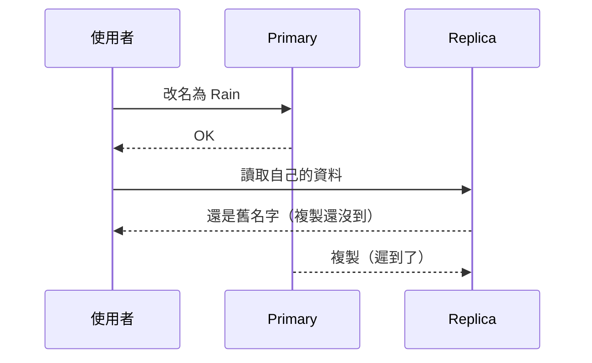

實務解法整理在[延伸篇第 1 題](/posts/system-design/lesson-01-deep-dive#1-replication-lag-實務上怎麼解)。

### Cache

**Cache-aside（書中稱 read-through）**：先查 cache，miss 才查 DB 並回填 cache。

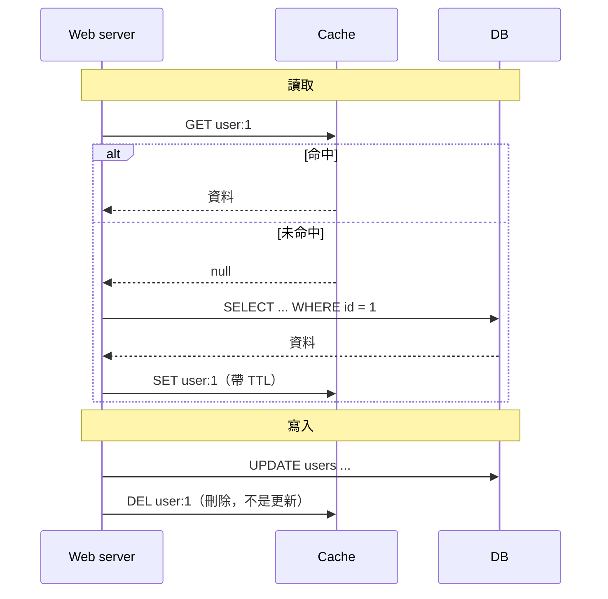

- 寫入時：**先更新 DB，再刪掉 cache key**，不要更新 cache（原因見延伸篇第 2 題）。
- 要背的五個考量：何時用 cache（讀多寫少）、**TTL**（太短 DB 壓力大，太長資料過期）、
  **一致性**、**SPOF**（多台節點、記憶體預留餘裕）、**eviction**（LRU、LFU、FIFO）。
- **Stampede（thundering herd）**：熱門 key 一過期，一萬個請求同時 miss 一起打 DB。
  解法：只讓一個請求重算、其他等它（lock、lease、request coalescing），TTL 加上隨機抖動。
- **真實案例：Facebook，*Scaling Memcache at Facebook*（NSDI 2013）。** 書中一致性那一點的出處。
  Look-aside cache、寫入時刪除而非更新，並用 **lease** 同時解決 stale set 和 thundering herd，
  規模是每秒數十億次請求。讀 3.2 和 3.3 節即可。

### CDN

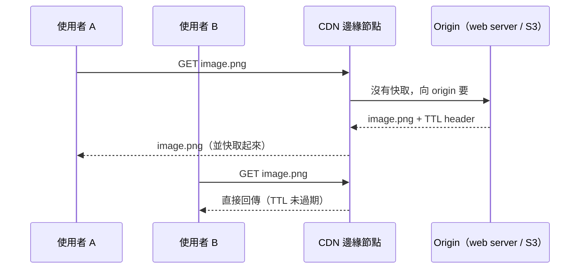

- 靜態內容放在靠近使用者的邊緣節點。離 CDN 越遠，網站越慢。
- 考量：成本（冷門檔不要放 CDN）、TTL、CDN 掛掉時要能退回 origin、
  失效方式有廠商 API 或**帶版本的 URL**（`app.js?v=2`，或檔名帶內容 hash）。
- **真實案例：Netflix Open Connect。** 影片是 Netflix 絕大部分的流量，所以它自建 CDN，
  把設備直接放進 ISP 的機房。

### 多資料中心

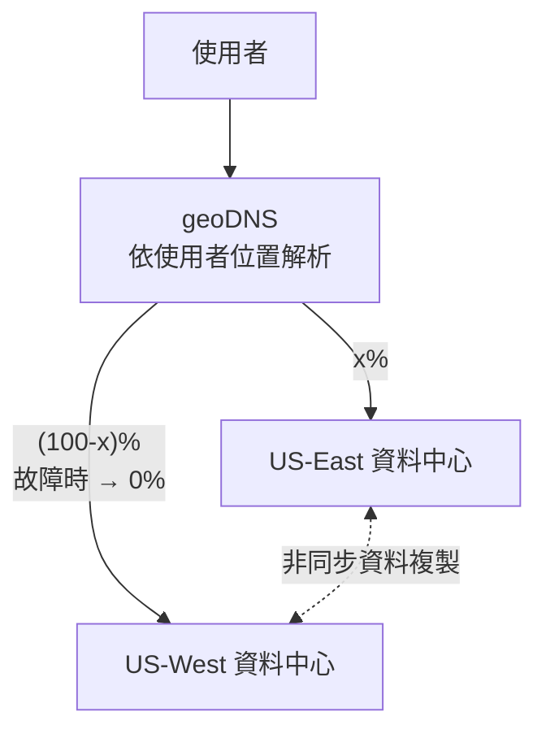

- geoDNS 把使用者導到最近的資料中心；一個資料中心掛了，就把 100% 流量導到另一個。
- 難點：流量導向、**跨區資料同步**（通常是非同步複製）、每個區域的測試與部署。
- **真實案例：Netflix active-active。** 2012 年聖誕夜 AWS US-East-1 的 load balancer 故障讓 Netflix 停擺，
  之後他們改成跨區 active-active（書中參考資料 [11]）。什麼是 active-active 見延伸篇第 4 題。

### Message queue

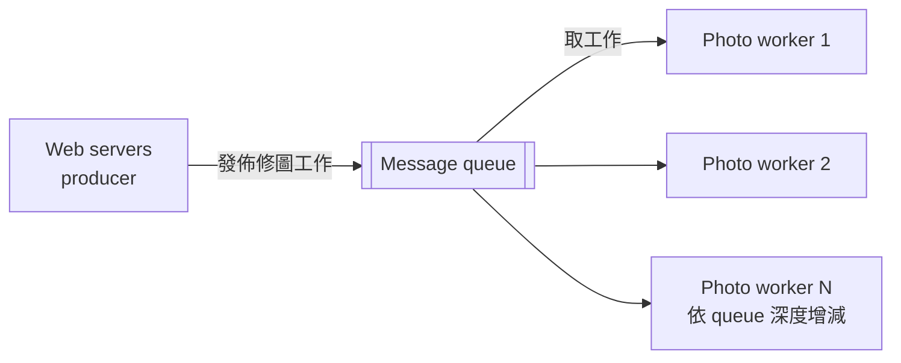

- Producer 發佈、consumer 處理，queue 在中間做緩衝。兩邊可以各自擴展、各自故障；
  consumer 不在時 producer 照樣能發，反之亦然。
- 書中的例子：修圖（裁切、銳化、模糊）很花時間，所以丟進 queue 由 worker 非同步處理。
  Queue 變長就加 worker，常常是空的就減 worker。
- 面試追問：投遞通常是 **at-least-once**，所以 consumer 必須**冪等**（idempotent）。
- **真實案例：Instagram，2011**（*What Powers Instagram*）。極小的團隊用 Django + Postgres、
  Redis、Memcached，並用 task queue（Gearman）處理非同步工作，例如推送給 follower、同步分享到 Twitter。

### Logging、metrics、automation

網站小的時候是好習慣，規模大了就是必需品：

- **Logging**：監控 error log，可以集中彙整方便搜尋。
- **Metrics**：主機層（CPU、記憶體、磁碟 I/O）、彙整層（整個 DB tier、cache tier 的效能）、
  業務層（DAU、留存、營收）。
- **Automation**：CI 在每次 check-in 時自動驗證，並自動化 build、test、deploy。

### Sharding

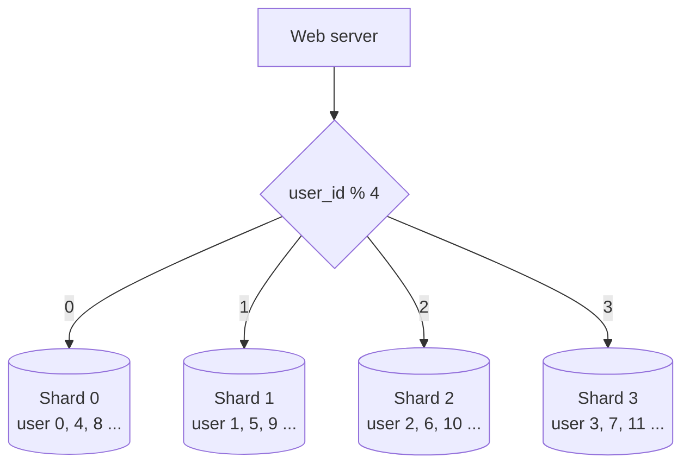

- 用 **sharding key** 把資料列分散到多個 DB（書中是 `user_id % 4`）。每個 shard 結構相同、資料不同。
- 選 key 的原則：**分布均勻**，而且**大多數查詢都會帶它**；否則每個查詢都得問遍所有 shard。
- 一定要點名的三個問題：
  1. **Resharding**：用 `% N` 時新增一個 shard，幾乎每一列都要搬家（consistent hashing 就是解這個）。
  2. **熱點／名人問題**：大量存取集中在某個 shard，例如幾位名人剛好落在同一個 shard。
  3. **不能跨 shard join**：改用反正規化（denormalization）。
- **真實案例：Instagram，2012**（*Sharding & IDs at Instagram*）。數千個**邏輯** shard
  （Postgres schema）對應到少數幾台**實體**伺服器，resharding 時搬整個邏輯 shard，而不是重新 hash 每一列。
  ID 裡內嵌 shard id。

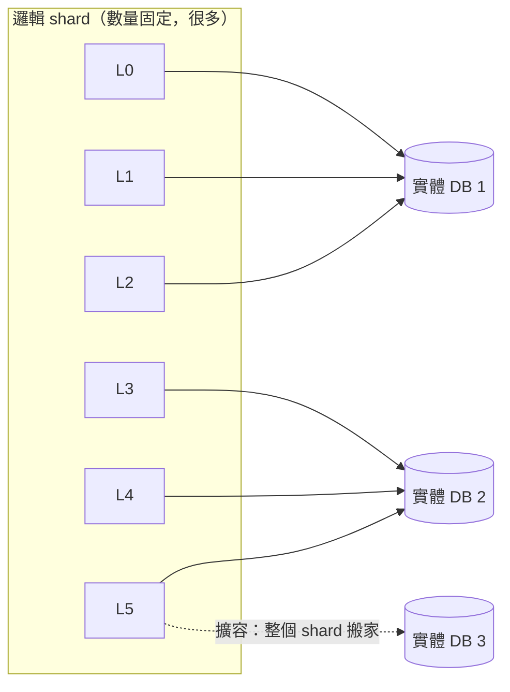

- **真實案例：Notion，2021**（*Herding elephants*）。同樣的做法，但做得晚：
  480 個邏輯 shard 分在 32 台實體 Postgres 上，不停機遷移。這是「等到需要時才 sharding」代價很高的好故事。

### 什麼時候選 NoSQL（書中的清單）

需要超低延遲、資料非結構化或沒有關聯、只需要序列化／反序列化、或資料量巨大。
其他情況預設用關聯式資料庫，並說明理由。更完整的判斷方式見延伸篇第 7 題。

## 3. 面試演練

**2 分鐘講稿。** 邊畫邊大聲講出來：

> Start with one server behind DNS. First, split the DB out so the tiers scale
> independently. Then put a load balancer in front of several web servers. For that, the
> web tier must be stateless, so sessions go to a shared store. Reads dominate, so add read
> replicas and a cache, with cache-aside and delete-on-write. Static assets go to a CDN. For
> availability, run two data centers behind geoDNS and replicate data between them. Slow
> work goes through a message queue to workers. Add logging, metrics and CI/CD. When writes
> or data size outgrow one primary, shard by a key that spreads evenly, and plan for
> resharding and hot keys.

**追問。** 先自己回答，再展開看答案。

LB 現在變成 SPOF 了，怎麼辦？

做成一對：active-passive 加浮動 IP（keepalived / VRRP），或 active-active 透過 DNS 放多筆 A record。
在雲端，託管的 LB（ALB、NLB）本身就跨 availability zone 備援。

Sticky session、共享 session store、JWT，怎麼選？

Sticky session：不用多加元件，但負載不均、縮容和部署很痛，伺服器一掛使用者就掉 session。
共享儲存：任何一台都能服務任何人，但多一個要高可用的元件、每個請求多一次查詢。
JWT：不用查詢，但在過期前無法撤銷（除非加 denylist，那又是狀態了），而且 token 比較大。

使用者改了個人資料，卻看到舊的。為什麼？怎麼修？

Replication lag：讀取打到了還沒收到寫入的 replica。寫入後短時間內，該使用者的讀取改走 primary，
或自己的資料一律走 primary。也可以帶上寫入位置（LSN 或版本號），等 replica 追上才從它讀。
另外也要檢查 cache：沒有被失效的舊 cache 看起來一模一樣。

為什麼寫入時要刪 cache key，而不是更新它？

兩個並行寫入 A 然後 B，更新 cache 的順序可能變成 B 然後 A，cache 就留下 A 的舊值，而且遲遲不會過期。
刪除是冪等的：下一次讀取會從 DB 重新回填。仍有一個競態（某個讀取在刪除前一刻用舊值回填），
Facebook 的 lease 就是補這個洞。

社群 app 的 sharding key 怎麼選？

選大多數查詢都會帶、而且分布均勻的 key，通常是 `user_id`。拿熱門路徑（「我的貼文」「我的動態」）來檢驗。
小心名人：某一個使用者的 shard 可能被打爆，熱門 key 要特別處理（專屬 shard、額外 replica、cache）。
用大量邏輯 shard 對應少量實體主機，resharding 時搬的是 shard 而不是一列列資料。

什麼時候不該 sharding？

當垂直擴展、read replica 和 cache 還有空間的時候。Stack Overflow 每月上千萬使用者時仍只有一台 primary。
Sharding 的代價是 join、交易和維運的簡單性，所以等寫入量或資料量逼你時再做。

## 延伸閱讀

- Facebook，*Scaling Memcache at Facebook*（NSDI 2013），第 3 節
- Instagram Engineering，*Sharding & IDs at Instagram*（2012）
- Nick Craver，*What it takes to run Stack Overflow*（2013）
- Notion，*Herding elephants: lessons learned from sharding Postgres at Notion*（2021）
